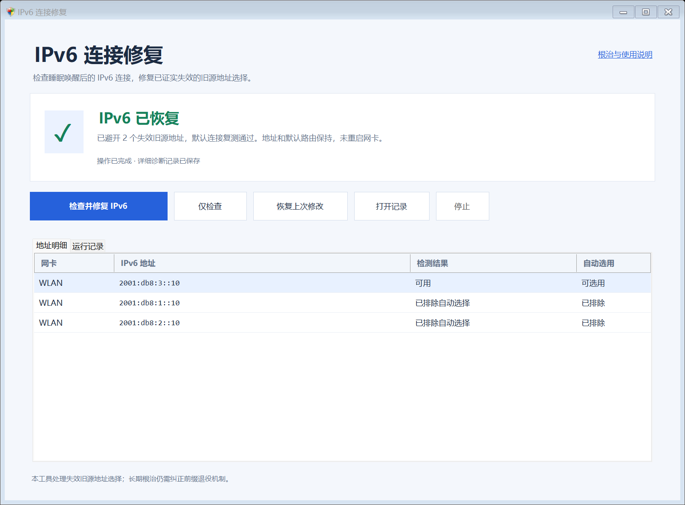

# IPv6 连接修复工具

Windows x64 便携客户端，用于检测并恢复一类 IPv6 故障：网络前缀改变后，已经不能访问外网的旧地址仍参与自动源地址选择。

[下载最新版本](https://github.com/Jie-account/ipv6-fix/releases/latest) · [使用说明](docs/usage.md) · [更新记录](CHANGELOG.md)

## 使用

1. 下载便携压缩包并解压。
2. 双击 `IPv6修复工具.exe`，允许管理员授权。
3. 点击“检查并修复 IPv6”，查看检测、修复和复测结果。

“仅检查”保持网络设置；“恢复上次修改”恢复本工具保存的最近一次修改。程序按需运行，不安装后台任务。记录保存在程序旁的 `Logs`，只读目录下会使用当前用户的本地应用数据目录。

## 它处理什么

对同一固定目标，默认连接及候选旧源地址重复失败，而另一前缀源地址重复成功时，工具才排除已经证实失效的旧源地址。修改前备份，写入前复核，默认访问复测通过才报告成功；中途失败则恢复原值。

工具保留地址与默认路由，不关闭 IPv6、不改 DNS、不重启网卡。证书/TLS 错误、全部地址都失败或其他不符合条件的问题会保留诊断结果，不套用此修复。长期根治仍需要纠正前缀退役机制，详见[修复条件与边界](docs/usage.md#自动修复的条件)。

## 环境与构建

适用于 Windows 10/11 x64，使用系统 .NET Framework、Windows PowerShell 5.1 和 curl。无需安装 Python、PowerShell 7 或第三方运行时。

~~~powershell
git clone https://github.com/Jie-account/ipv6-fix.git
cd ipv6-fix
.\client\Package.ps1
~~~

构建使用系统 C# 5 编译器，无需 NuGet 或网络下载。源码、构建和测试入口见 [client/README.md](client/README.md)。

## 验证

- 15 项网络决策和恢复测试，覆盖健康状态不修改、瞬时失败、故障类型判别、部分失败、取消与回退。
- 14 个布局场景，在当前系统 DPI 上使用不同文字比例，检测重叠、裁切及区块布局。
- 合成测试使用 `2001:db8::/32` 文档地址；仓库不包含个人抓包、诊断现场或运行记录。
- Windows 持续集成负责构建、逻辑与布局测试；实际网络修复效果按具体网络和现场验证。
